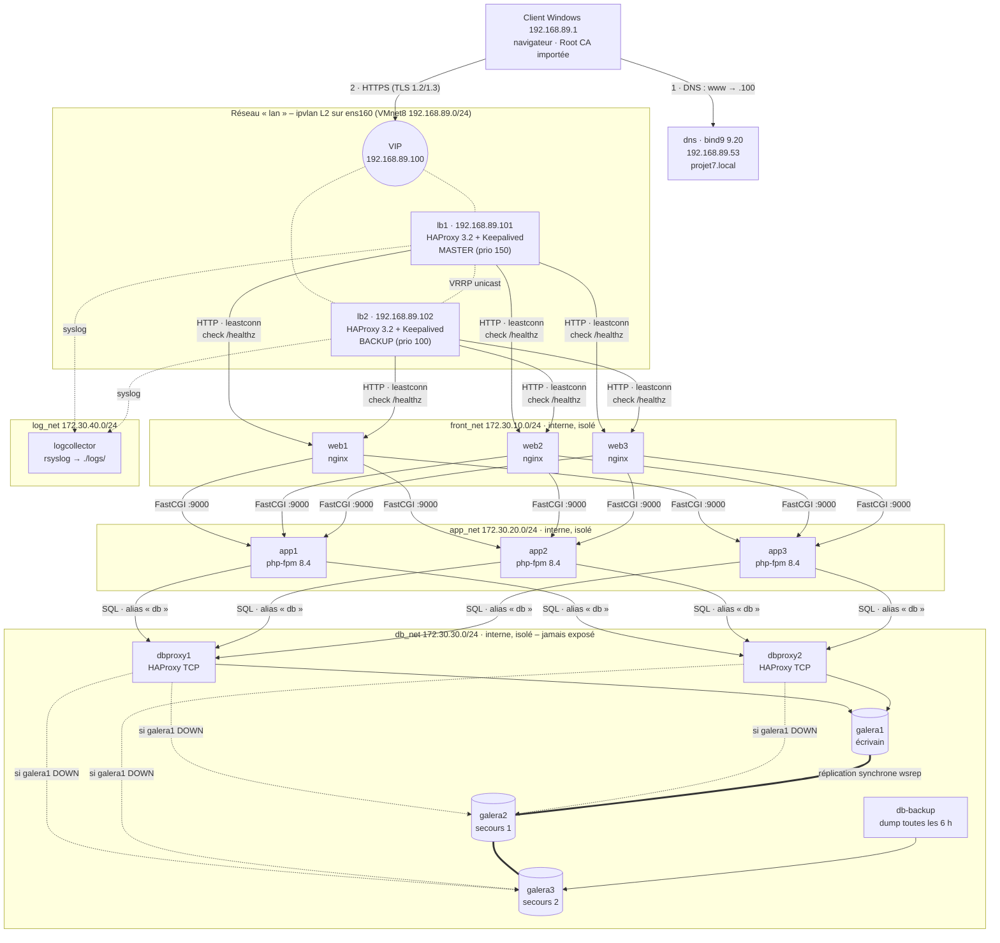

# Projet 7 – Site web N-tiers haute disponibilité · `https://www.projet7.local`


Une application web « vitrine HA » servie **uniquement en HTTPS**, sans point unique de défaillance de bout en bout :

- 2 load balancers HAProxy + Keepalived qui se partagent une IP virtuelle (VIP) ;
- 3 serveurs web nginx, 3 serveurs applicatifs php-fpm ;
- 2 proxys SQL devant un cluster MariaDB Galera à 3 nœuds ;
- un DNS bind9 et une PKI interne.

Le tout tient en **16 conteneurs Docker** sur une VM RHEL 10, avec SELinux en mode *Enforcing* et firewalld actif.

| Panne provoquée (`docker kill`) | Indisponibilité mesurée | Données |
|---|---|---|
| 2 serveurs web sur 3 | **0 s** | – |
| 2 serveurs app sur 3 | **0 s** | – |
| 1 proxy SQL sur 2 | **0 s** | – |
| Le nœud Galera écrivain | **4,0 s** | **0 écriture perdue** |
| Le load balancer MASTER (VIP) | **3,6 s** | – |

Tests automatisés avec une sonde HTTPS à 5 requêtes/s : [docs/resultats-tests/](docs/resultats-tests/README.md).

---

## 1. Architecture



### Plan d'adressage
| Composant | Adresse(s) | Rôle |
|---|---|---|
| VM RHEL (ens160) | 192.168.89.136 (DHCP VMnet8) | hôte Docker |
| Client Windows | 192.168.89.1 | test, administration (seul autorisé sur les stats) |
| Passerelle / DNS VMware | 192.168.89.2 | NAT VMnet8 |
| `dns` (ns1) | 192.168.89.53 | DNS faisant autorité pour `projet7.local` |
| **VIP** | **192.168.89.100** | `www.projet7.local`, portée par lb1 ou lb2 |
| `lb1` / `lb2` | 192.168.89.101 / .102 · front .21/.22 · log .21/.22 | HAProxy + Keepalived |
| `p7-shim` (facultatif) | 192.168.89.99/32 | permet à la VM elle-même de joindre la VIP |
| `web1-3` | front 172.30.10.11-13 · app 172.30.20.21-23 | nginx 1.30.6 |
| `app1-3` | app 172.30.20.11-13 · db 172.30.30.41-43 | php-fpm 8.4.27 |
| `dbproxy1/2` (alias `db`) | 172.30.30.21/.22 | HAProxy TCP, un seul écrivain |
| `galera1-3` | 172.30.30.11-13 | MariaDB 11.4.13 + Galera 4 |
| `db-backup` | 172.30.30.31 | `mariadb-dump` planifié |
| `logcollector` | 172.30.40.10 (+ 127.0.0.1:5514/udp) | rsyslog central |

### Chemin d'une requête
1. `www.projet7.local` est résolu en 192.168.89.100, par bind9 ou par le fichier hosts.
2. Le LB qui détient la VIP termine le TLS et applique le rate limiting, le filtrage des noms d'hôte et des méthodes, ainsi que les en-têtes de sécurité.
3. HAProxy choisit un serveur web parmi ceux qui sont UP, en `leastconn`.
4. Le serveur web nginx choisit un serveur applicatif php-fpm parmi les 3.
5. php-fpm se connecte à l'alias `db`, servi par l'un des 2 dbproxy, qui envoie vers **l'écrivain unique** galera1 (ou galera2/3 en secours).
6. La transaction (compteur + visite) est répliquée de manière synchrone sur les 3 nœuds avant d'être validée.

---

## 2. Justification des choix

### Load balancer : pourquoi HAProxy (plutôt que Nginx ou Traefik)
| Critère | **HAProxy** | Nginx (OSS) | Traefik |
|---|---|---|---|
| Health checks HTTP **actifs** | ✅ natifs (`httpchk`, `fastinter`) | ❌ (réservé à Nginx Plus) | ✅ |
| Détection passive + nouvel essai sur un autre serveur | ✅ `observe layer4`, `redispatch 1`, `retry-on` | partiel (`proxy_next_upstream`) | partiel |
| Stick-tables / rate limiting par IP | ✅ très fin | `limit_req` | middleware |
| Page de stats temps réel + socket d'admin | ✅ | ❌ (Plus) | dashboard / API |
| TCP **et** HTTP (réutilisé pour dbproxy) | ✅ | ✅ (stream) | ✅ |
| Couplage Keepalived (`track_script`) | standard de fait | possible | peu courant |
| Orientation | LB pur, configuration statique explicite | serveur web + proxy | découverte dynamique (labels) : utile en orchestrateur, superflu ici |

HAProxy est utilisé **deux fois** : en frontal HTTP/TLS et en proxy SQL TCP, ce qui fait un seul outil à maîtriser.

### VIP : Keepalived (VRRP) sur un réseau ipvlan L2
| Option | Problème |
|---|---|
| `network_mode: host` | Les 2 Keepalived partagent la même pile réseau : il n'y a plus de vraie élection VRRP, et la VIP n'est qu'une IP de plus de la VM. |
| macvlan | Une adresse MAC par conteneur, ce qui exige le mode promiscuité sur le vSwitch VMware. |
| **ipvlan L2** ✅ | Chaque LB a **sa propre IP sur le LAN**, avec la MAC de la VM : aucun réglage VMware, et le client Windows joint directement la VIP. |

Les contraintes d'ipvlan ont été traitées :
- l'hôte ne peut pas joindre ses propres sous-interfaces ipvlan : le shim `p7-shim` est facultatif ;
- la VIP ne peut pas exister sur deux conteneurs à la fois (`EADDRINUSE`) pendant une préemption : le script `vip-ensure.sh` réessaie l'ajout.

Réglages VRRP :
- **unicast** entre .101 et .102 (pas de multicast sur le vSwitch) ;
- `track_script` : un LB dont HAProxy ne répond plus, ou qui n'a plus aucun web UP, cède la VIP ;
- `preempt_delay 10` : lb1 ne reprend la VIP qu'une fois stabilisé, sans perte mesurée.

Chaque LB est **un seul conteneur** qui contient HAProxy et Keepalived, sous un superviseur : si l'un des deux processus meurt, le conteneur s'arrête et la VIP est libérée. On évite ainsi un Keepalived vivant à côté d'un HAProxy mort.

### Web et app séparés (3 + 3)
- C'est un vrai découpage en tiers : chaque nginx répartit sur les 3 php-fpm, donc on peut perdre 2 web **ou** 2 app sans interruption (0 s mesuré).
- Le serveur web n'a **aucun accès** à la base : il n'est pas sur `db_net`.
- L'application est **sans état** (aucune session PHP, tout est en base) : les **sticky sessions ne sont pas nécessaires**. La directive `cookie` qui les activerait est documentée en commentaire dans `lb/haproxy.cfg`.

### Base : pourquoi MariaDB Galera (plutôt qu'un couple primaire/réplique)
| Critère | **Galera (3 nœuds)** | Primaire / réplique asynchrone |
|---|---|---|
| Perte de données si le primaire tombe (RPO) | **0** : validation synchrone sur tous les nœuds | les transactions non répliquées sont perdues |
| Bascule | automatique, tout nœud est inscriptible | promotion d'une réplique (outil supplémentaire) |
| Retour d'un nœud | automatique : IST (incrémental) ou SST (`mariabackup`) | reconstruction de la réplique |
| Split-brain | impossible : quorum, seul le composant majoritaire reste « Primary » | risque sans fencing |

Il faut **3 nœuds** : on tolère 1 panne en gardant la majorité (2/3). Avec 2 nœuds, la moindre coupure bloque tout.

**dbproxy ×2 avec un écrivain unique** : toutes les écritures vont sur galera1, ce qui évite les conflits de certification entre nœuds (le compteur est une ligne très sollicitée). Un nœud n'est considéré UP que s'il est **Synced + Primary + ready** (script de check externe), et pas seulement joignable en TCP. Les 2 dbproxy partagent l'alias DNS Docker `db` : il n'y a pas de SPOF.

### Autres choix
| Choix | Justification |
|---|---|
| **PKI interne à 2 niveaux** | La Root CA (RSA 4096, 10 ans) est **hors ligne** et signe une intermédiaire (5 ans) **contrainte** à `projet7.local` (`nameConstraints`, `pathlen:0`). Le certificat serveur est en ECDSA P-256, valable 397 jours, avec SAN `www.projet7.local` + `projet7.local`. Une compromission de l'intermédiaire ne permet de signer aucun autre domaine. |
| **bind9 faisant autorité seulement** | Pas de récursion : ce n'est pas un résolveur ouvert, il n'y a pas d'empoisonnement de cache. Côté Windows, une règle NRPT n'envoie que `projet7.local` vers .53. |
| Docker CE + Compose | C'est imposé par le sujet. Podman (natif RHEL) reste installé ; seul `podman-docker` a été retiré pour éviter le conflit sur la commande `docker`. |
| Images officielles **épinglées** | Versions exactes (`mariadb:11.4.13-noble`, `haproxy:3.2.26-alpine`, `nginx:1.30.6-alpine`, `php:8.4.27-fpm-alpine`, `alpine:3.24.4`) et paquets Alpine épinglés (`keepalived=2.3.4-r2`, `bind=9.20.30-r0`…) : chaque build est reproductible. |

---

## 3. Sécurité et durcissement

| Thème | Mise en œuvre |
|---|---|
| **HTTPS uniquement** | Port 80 : redirection 301 vers HTTPS. **HSTS** pendant 2 ans. **TLS 1.2/1.3 seulement**, suites AEAD + PFS (profil Mozilla *intermediate*), `no-tls-tickets`, HTTP/2. Vérifié : TLS 1.0/1.1 et suites faibles refusés. |
| En-têtes HTTP | CSP stricte (`default-src 'none'`), `X-Content-Type-Options`, `X-Frame-Options DENY`, `Referrer-Policy`, `Permissions-Policy`, COOP/CORP. En-têtes `Server` et `X-Powered-By` supprimés. |
| Filtrage | Seul l'hôte `www.projet7.local` est accepté (apex → 301 vers www, autre → 421) ; seules GET/HEAD sont acceptées (sinon 405). |
| **Rate limiting** | Par IP, via stick-table : au-delà de 100 requêtes / 10 s ou de 30 connexions simultanées → **429** (mesuré : 84 × 200 puis 66 × 429). |
| Page de stats | HTTPS sur `:8404`, **réservée à 192.168.89.1** (403 avant même l'authentification pour tout autre client), utilisateur + empreinte SHA-512 hors image. |
| **Secrets** | `.env` (mode 600, **non versionné**, mots de passe aléatoires de 32 caractères) → `secrets/` (700, label SELinux `container_file_t`) → `/run/secrets` en lecture seule. Aucun secret en variable d'environnement, en ligne de commande ou dans `docker inspect`. |
| **Conteneurs non-root** | nginx uid 101, php-fpm uid 82, HAProxy uid 99, mariadbd uid 999, bind uid 100, backup et rsyslog uid 1000. Seul Keepalived reste root, avec `NET_ADMIN`/`NET_RAW`, pour la VIP. |
| Confinement | `cap_drop: ALL` (seules les capacités nécessaires sont rendues), `no-new-privileges`, **rootfs en lecture seule** (+ tmpfs) pour web, app, lb, dbproxy, dns, backup et logcollector ; limites mémoire. |
| Réseaux | Un réseau par tier, `internal: true` (pas de sortie Internet) et `gateway_mode_ipv4: isolated` (la VM elle-même ne joint pas les tiers internes). **La base n'est jamais exposée** : aucun port publié, injoignable depuis l'hôte et depuis le tier web. php-fpm n'accepte que les 3 nginx (`listen.allowed_clients`). |
| Base | Comptes au moindre privilège (`vitrine` en DML seulement, `monitor` en USAGE, `root` en localhost uniquement) ; `innodb_force_primary_key`. |
| **SELinux / firewalld** | SELinux **Enforcing** (volumes labellisés `:z`/`:Z`, catégories MCS par conteneur) ; firewalld **actif**. Seuls `ssh`, `cockpit` et `dhcpv6-client` sont ouverts sur la VM : le trafic ipvlan va directement aux conteneurs, et la surface exposée se limite à HAProxy (80, 443, 8404) et bind (53). Le port 8889 a été fermé en phase 0. |
| **Journaux centralisés** | Tous les conteneurs passent par le pilote syslog vers `logcollector` (rsyslog, non-root) : un fichier par source dans `./logs/` (`haproxy-lb1.log`, `galera1.log`, `dns.log`…) + `all.log`. `docker logs` reste disponible. |
| Sauvegardes | `mariadb-dump --single-transaction` toutes les 6 h depuis un nœud de secours, rétention 7 jours, SHA-256, fichiers en 600 ; restauration vérifiée dans une instance jetable. |
| Git | `.gitignore` : `.env*` (sauf `.env.example`), `pki/**/private/`, `*.key`, `secrets/`, `backups/`, `*.sql*`, `logs/`. |

---

## 4. Installation

Prérequis : une VM RHEL 10 (2 vCPU, 4 Go de RAM au minimum ; la plateforme consomme **≈ 600 Mo**), une carte réseau sur VMnet8 (NAT), un accès Internet pour les images, et SELinux + firewalld actifs.

```bash
git clone <dépôt> ~/projet7-ha && cd ~/projet7-ha

# 1. Prérequis hôte (sudo) – simulation par défaut, puis application
#    Docker CE depuis le dépôt officiel (clé GPG vérifiée), daemon.json, module ipvlan
./scripts/install_prereqs.sh            # affiche ce qui sera fait
sudo ./scripts/install_prereqs.sh --apply
newgrp docker                           # ou se reconnecter (groupe docker)

# 2. PKI : Root CA + intermédiaire + certificat serveur, puis Root CA mise hors ligne
./scripts/pki.sh all
./scripts/pki.sh offline                # archive chiffrée de la clé racine, puis shred

# 3. Secrets et déploiement (sans sudo, idempotent)
./scripts/deploy.sh init-env            # .env (600) avec mots de passe aléatoires
./scripts/deploy.sh all                 # db → web → lb → dns, chaque étape attend « healthy »
./scripts/healthcheck.sh                # doit finir par « Plateforme dans l'état nominal »
```

`deploy.sh` permet aussi de déployer un seul tier (`db`, `web`, `lb`, `dns`), d'afficher l'état (`status`) ou de tout arrêter (`down`, données conservées).

Comportement :
- **les mises à jour sont tournantes**, un conteneur à la fois, en attendant qu'il soit sain : 267/267 requêtes réussies pendant la mise à jour de 11 conteneurs ;
- **démarrage de Galera** : après un arrêt propre ou un crash total, le nœud le plus avancé est choisi automatiquement (`safe_to_bootstrap`, sinon `wsrep-recover`).

Facultatif, pour que la VM elle-même joigne la VIP : créer le shim NetworkManager persistant (commande expliquée dans [docs/phase5-lb.md](docs/phase5-lb.md#shim-hôte-persistant--optionnel-non-encore-créé)).

### Côté client Windows
1. **Importer la Root CA**. Vérifier d'abord l'empreinte SHA-256 `E9:C5:4A:C6:…:AD:23:A4:EA`, puis, dans un PowerShell administrateur :
   ```powershell
   Import-Certificate -FilePath root-ca.cer -CertStoreLocation Cert:\LocalMachine\Root
   ```
   Détails et cas de Firefox : [docs/pki.md §5](docs/pki.md#5-import-de-la-root-ca-sur-le-client-windows).
2. **Résolution du nom**, au choix :
   - **DNS bind9** (recommandé). La règle NRPT n'envoie que `projet7.local` vers .53 ; le reste d'Internet n'est pas touché.
     ```powershell
     Add-DnsClientNrptRule -Namespace "projet7.local", ".projet7.local" -NameServers "192.168.89.53"
     Clear-DnsClientCache
     Resolve-DnsName www.projet7.local    # → 192.168.89.100
     ```
   - **Fichier hosts** (secours, aucune dépendance) : dans `C:\Windows\System32\drivers\etc\hosts`, ouvert avec le bloc-notes lancé en administrateur, ajouter
     ```
     192.168.89.100  www.projet7.local projet7.local
     ```
     Le fichier hosts est prioritaire sur le DNS. Détails : [docs/phase6-dns.md](docs/phase6-dns.md).
3. Ouvrir `https://www.projet7.local`. Le cadenas doit indiquer « Vérifié par : Projet7 HA ».

### Variante Let's Encrypt
`.local` ne peut pas être certifié par une CA publique. Avec un vrai domaine, on utiliserait le défi **DNS-01** (aucun port à ouvrir), un hook de déploiement vers `secrets/haproxy_pem` et un renouvellement automatique : [docs/pki.md §6](docs/pki.md#6-variante-lets-encrypt-domaine-public).

---

## 5. Exploitation
| Besoin | Commande |
|---|---|
| État global (conteneurs, wsrep, écrivain, VIP, web vus par chaque LB, DNS) | `scripts/deploy.sh status` |
| État nominal ? (code retour 0/1) | `scripts/healthcheck.sh` |
| Journaux | `tail -f logs/haproxy-lb1.log` · `logs/galera1.log` · `logs/all.log` |
| Statistiques HAProxy | `https://www.projet7.local:8404/stats` depuis 192.168.89.1 (`admin` / `HAPROXY_STATS_PASSWORD` du `.env`) |
| Sauvegardes | `scripts/backup_db.sh now \| list \| verify \| restore <fichier>` |
| Rotation d'un secret | vider la valeur dans `.env`, puis `deploy.sh init-env`, puis `deploy.sh <tier>` ([docs/durcissement.md](docs/durcissement.md)) |
| Tests de bascule | `scripts/test_failover_{web,app,dbproxy,db,lb}.sh` · `scripts/test_failover_all.sh` |

---

## 6. Résultats des tests

### Bascules automatisées ([docs/phase7-tests.md](docs/phase7-tests.md))
Méthode :
- une sonde envoie `GET https://www.projet7.local/api` sur la VIP toutes les 0,2 s, depuis le LAN, avec un timeout de 2 s et le certificat validé ;
- la panne est provoquée par `docker kill` (arrêt brutal) et maintenue 20 s, puis les conteneurs sont redémarrés et le **retour à l'état nominal** est vérifié ;
- l'analyse mesure l'indisponibilité, vérifie que le compteur est **strictement croissant** et qu'aucune écriture n'est perdue ;
- chaque test produit un rapport horodaté.

| Panne | Requêtes en échec | Indisponibilité max | Détection / bascule | Verdict |
|---|---|---|---|---|
| web1 + web2 | **0** / 207 | **0 s** | retirés du pool en ≈ 2-4 s, les requêtes en cours sont rejouées | ✅ |
| app1 + app2 | **0** / 191 | **0 s** | nginx passe au php-fpm suivant en ≤ 0,5 s | ✅ |
| dbproxy1 | **0** / 212 | **0 s** | l'alias `db` ne pointe plus que sur dbproxy2 | ✅ |
| galera1 (écrivain) | 2 / 210 | **4,0 s** | écrivain → galera2 en < 2 s ; quorum 2/3 ; retour par **IST** en 14 s ; **3 nœuds identiques, 0 écriture perdue** | ✅ |
| lb1 (MASTER) | 3 / 217 | **3,6 s** | VIP sur lb2 en ≈ 3,4 s ; reprise par lb1 **sans perte** | ✅ |

Ces tests ont fait évoluer la configuration :
- **web** : 2,2 s → 0 s, grâce à `timeout connect 500ms`, `redispatch 1` et `retry-on` ;
- **app** : 2,2 s → 0 s, grâce à `fastcgi_connect_timeout 500ms` ;
- **db** : 6,6 s → 4,0 s, avec une détection passive dans dbproxy.

Les durées restantes viennent des délais de détection propres à Galera (`evs.suspect_timeout`) et à VRRP (3 annonces manquées). Ils ont été conservés volontairement pour éviter les fausses bascules.

### Autres validations
| Domaine | Test | Résultat |
|---|---|---|
| TLS | TLS 1.0/1.1 et suites faibles (`AES128-SHA`, `DES-CBC3-SHA`…) | ✅ refusés |
| TLS | Chaîne validée par la Root CA, HTTP/2, HSTS | ✅ `Verify return code: 0` |
| HTTP | `http://` → 301 ; apex → www ; hôte inconnu → 421 ; POST → 405 | ✅ |
| Rate limiting | Rafale de 150 requêtes | ✅ 84 × 200 puis 66 × 429 |
| Galera | Crash simultané des 3 nœuds (SIGKILL) | ✅ reprise automatique (`wsrep-recover`), aucune perte |
| Galera | Redémarrage tournant sous écriture continue | ✅ 59/60 écritures |
| Sauvegarde | Dump puis restauration dans une instance jetable | ✅ données et comptes restaurés, import idempotent |
| Déploiement | Mise à jour tournante de 11 conteneurs sous trafic | ✅ 267/267 requêtes en 200 |
| Isolation | Base depuis l'hôte, web → base, app → Internet, conteneur intrus → php-fpm | ✅ tout refusé |
| DNS | Récursion, AXFR, `version.bind` | ✅ REFUSED / refusé / vide |
| Client Windows | Pannes web, app, galera1, dbproxy1, lb1 provoquées à la main | ✅ site toujours servi, cadenas valide |

Le détail par phase se trouve dans les fichiers `docs/phaseN-*.md`.

---

## 7. Arborescence
```
docker-compose.yml        16 services, 5 réseaux, secrets fichiers
.env.example              modèle des secrets (le .env réel n'est jamais versionné)
lb/                       HAProxy + Keepalived (haproxy.cfg, keepalived.conf.tmpl, superviseur, vip-ensure.sh)
web/nginx.conf            tier web
app/                      image php-fpm + appli « vitrine HA » (src/index.php)
db/                       galera.cnf, entrypoint, initdb, dbproxy/, backup/
dns/                      bind9 (named.conf, zone db.projet7.local)
logging/                  collecteur rsyslog
pki/                      configs openssl, certificats (clés privées exclues de git)
scripts/                  install_prereqs, pki, deploy, healthcheck, backup_db, test_failover_*
tests/probe/              sonde HTTPS des tests de bascule
docs/                     rapports de phase, PKI, durcissement, résultats des tests
```

## 8. Limites et pistes
- **Une seule VM** : c'est le seul point unique restant (hyperviseur, disque). En production, il faudrait répartir lb, web, app et galera sur 3 hôtes ; l'architecture n'a pas à changer, il suffit de remplacer les réseaux par un overlay ou un VLAN.
- DNS : un serveur secondaire `ns2` sur un autre hôte. Aujourd'hui, ce n'est pas un SPOF du service, puisque la VIP est fixe et que le fichier hosts sert de secours.
- Sauvegardes : copie hors site (règle 3-2-1) et binlogs pour une restauration à un instant précis.
- Supervision : export Prometheus (HAProxy l'intègre nativement) et alertes.
